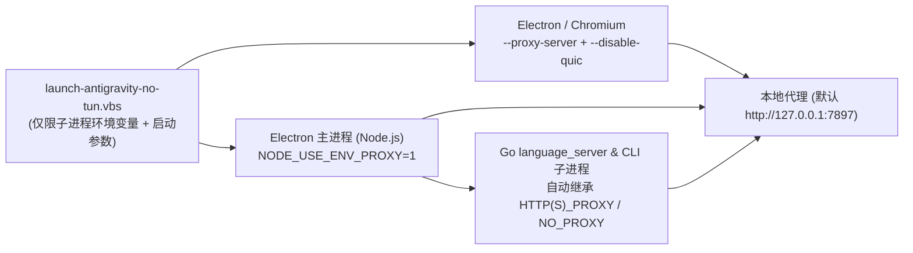

# Antigravity Windows No-TUN Launcher

Google Antigravity 2.x 的 **Windows 免 TUN、零侵入、跨更新持久生效** 无黑窗启动器。

无需开启全局 TUN，无需向安装目录复制 `version.dll` 劫持文件，不修改 `app.asar` 与程序签名，默认兼容 [船板 Antigravity 主题补丁 v6.0.0+](https://github.com/Anarcadia/chuanban-antigravity-theme-patch)（自动携带 `--remote-debugging-port=0`）。

---

## 原理一览

Antigravity 运行时由 3 层独立网络栈组成：



- **不改安装目录**：脚本存放在 `%USERPROFILE%\.gemini\antigravity\scripts\`，客户端升级不会冲掉配置。
- **不污染系统环境变量**：代理变量只写入当前 `Antigravity.exe` 及其子进程的 `PROCESS` 环境块。
- **自动尊重 `NO_PROXY`**：自动继承你已有的用户级 `NO_PROXY`（内网地址、私有网段、Tailscale 等照常直连）。

---

## 快速安装（Windows）

确保本机代理已启动（默认端口 `http://127.0.0.1:7897`，适配 Clash Verge / Mihomo 混合端口）：

```powershell
git clone https://github.com/hqc135/antigravity-windows-no-tun-launcher.git
cd antigravity-windows-no-tun-launcher
powershell -ExecutionPolicy Bypass -File .\install.ps1
```

如果本地代理不是 `7897` 端口，安装时直接指定即可：

```powershell
powershell -ExecutionPolicy Bypass -File .\install.ps1 -ProxyUrl "http://127.0.0.1:7890"
```

安装脚本会自动完成：
1. 将无黑窗脚本部署至 `%USERPROFILE%\.gemini\antigravity\scripts\launch-antigravity-no-tun.vbs`；
2. 原地更新桌面与开始菜单的 `Antigravity.lnk` 快捷方式（保留原图标，不增加多余图标）；
3. 若安装目录存在旧版 `version.dll` / `config.json`，自动移至 `%USERPROFILE%\.gemini\antigravity\backup-no-tun-dll\` 备份（不删除）。

完成后，**完全退出 Antigravity，再双击桌面或开始菜单图标重启**即可生效。

---

## 常用选项与环境变量

- **临时切换代理端口**：设置用户环境变量 `ANTIGRAVITY_PROXY_URL`（如 `http://127.0.0.1:7890`），无需重新安装。
- **关闭 CDP 调试端口参数**：安装时加 `-DisableCdp`，或设置用户环境变量 `ANTIGRAVITY_DISABLE_CDP=1`。
- **一键卸载还原**：
  ```powershell
  powershell -ExecutionPolicy Bypass -File .\uninstall.ps1
  ```
  如需还原快捷方式同时保留船板主题补丁的 `--remote-debugging-port=0`，可加 `-KeepCdpFlag`。

---

## 验证是否生效

重启 Antigravity 后，在 PowerShell 中执行：

```powershell
Get-CimInstance Win32_Process -Filter "Name = 'Antigravity.exe'" |
  Where-Object { $_.CommandLine -notmatch '--type=' } |
  Select-Object ProcessId, CommandLine | Format-List
```

看到命令行包含 `--proxy-server="http://127.0.0.1:7897"` 与 `--disable-quic` 即代表启动器已接管。

---

## 已知边界说明

- **软件内热更新自动重启的那一次**：Antigravity 自动更新完毕自行拉起时不会经过桌面快捷方式，那一次启动会暂时不带代理参数。完全退出客户端后重新点一次桌面图标即可恢复。
- **致谢与思路来源**：免改盘外部 `.vbs` 启动器的进程环境变量继承思路参考了 [elviscjn-cjn/antigravity-context-viewer](https://github.com/elviscjn-cjn/antigravity-context-viewer)，同时默认兼容 [Anarcadia/chuanban-antigravity-theme-patch](https://github.com/Anarcadia/chuanban-antigravity-theme-patch) 的 CDP 注入机制。

---

## 相关文档

- 入门图文教程（知乎版）：[docs/zhihu-guide.md](docs/zhihu-guide.md)
