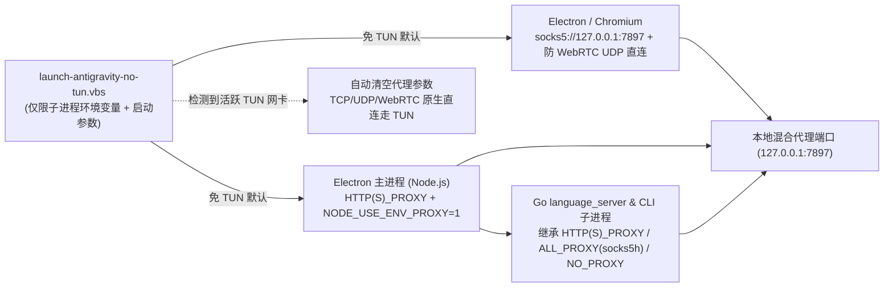

# Antigravity Windows No-TUN Launcher

Google Antigravity 2.x 的 **Windows 免 TUN、零侵入、跨更新持久生效** 无黑窗启动器。

无需开启全局 TUN，无需向安装目录复制 `version.dll` 劫持文件，不修改 `app.asar` 与程序签名，默认兼容 [船板 Antigravity 主题补丁 v6.0.0+](https://github.com/Anarcadia/chuanban-antigravity-theme-patch)（自动携带 `--remote-debugging-port=0`）。

---

## 原理一览

Antigravity 运行时由 3 层独立网络栈组成，启动器按协议特性做了前后端分流与 TUN 自动感知：



- **前后端协议分流（更稳的双向流）**：Chromium 前端走 `socks5://127.0.0.1:7897` 无缓冲五层流通道（避免 HTTP 代理缓冲干扰 WebSocket 与流式连接），并附带 `--force-webrtc-ip-handling-policy=disable_non_proxied_udp` 防止实时语音尝试直连海外 UDP 卡死；Node.js 与 Go `language_server` 仍走 `HTTP(S)_PROXY=http://127.0.0.1:7897`，`ALL_PROXY` 设为 `socks5h://127.0.0.1:7897`。
- **TUN 模式自动感知**：启动瞬间检测是否存在已连接的 `Mihomo / Clash / Meta / Wintun / sing-box` 虚拟网卡；若临时开启了 TUN，双击同一个桌面图标也会自动剥离代理参数、避免双层代理套娃。
- **不改安装目录、不污染全局环境**：脚本存放在 `%USERPROFILE%\.gemini\antigravity\scripts\`，客户端升级不会冲掉配置；代理变量只写入当前 `Antigravity.exe` 及其子进程的 `PROCESS` 环境块。
- **自动尊重并规范化 `NO_PROXY`**：继承用户级 `NO_PROXY`（内网地址、私有网段、Tailscale `*.ts.net` / `100.64.0.0/10` 照常直连），并自动将 `::1` 规范化为 Chromium 要求的 `[::1]`。

---

## 快速安装（Windows）

确保本机代理已启动（默认端口 `http://127.0.0.1:7897`，适配 Clash Verge / Mihomo 混合端口）：

```powershell
git clone https://github.com/hqc135/antigravity-windows-no-tun-launcher.git
cd antigravity-windows-no-tun-launcher
powershell -ExecutionPolicy Bypass -File .\install.ps1
```

如果本地代理不是 `7897` 端口，安装时直接指定即可：

```powershell
powershell -ExecutionPolicy Bypass -File .\install.ps1 -ProxyUrl "http://127.0.0.1:7890"
```

安装脚本会自动完成：
1. 将无黑窗脚本部署至 `%USERPROFILE%\.gemini\antigravity\scripts\launch-antigravity-no-tun.vbs`；
2. 原地更新桌面与开始菜单的 `Antigravity.lnk` 快捷方式（保留原图标，不增加多余图标）；
3. 若安装目录存在旧版 `version.dll` / `config.json`，自动移至 `%USERPROFILE%\.gemini\antigravity\backup-no-tun-dll\` 备份（不删除）。

完成后，**完全退出 Antigravity，再双击桌面或开始菜单图标重启**即可生效。

---

## 常用选项与环境变量

- **临时切换代理端口**：设置用户环境变量 `ANTIGRAVITY_PROXY_URL`（如 `http://127.0.0.1:7890`），无需重新安装。
- **纯 HTTP 代理端口兼容（非混合端口）**：默认假定本地代理端口同时支持 HTTP 与 SOCKS5（Clash Verge / Mihomo 混合端口默认如此）；若你的代理端口仅支持纯 HTTP，可额外设置 `ANTIGRAVITY_CHROMIUM_PROXY_URL=http://127.0.0.1:<端口>`。
- **强制走代理（跳过 TUN 网卡检测）**：设置用户环境变量 `ANTIGRAVITY_FORCE_PROXY=1`。
- **关闭 CDP 调试端口参数**：安装时加 `-DisableCdp`，或设置用户环境变量 `ANTIGRAVITY_DISABLE_CDP=1`。
- **预览实际生成的启动命令（Dry Run）**：
  ```powershell
  cscript //Nologo "$HOME\.gemini\antigravity\scripts\launch-antigravity-no-tun.vbs" --dry-run-print-cmd
  ```
- **一键卸载还原**：
  ```powershell
  powershell -ExecutionPolicy Bypass -File .\uninstall.ps1
  ```
  如需还原快捷方式同时保留船板主题补丁的 `--remote-debugging-port=0`，可加 `-KeepCdpFlag`。

---

## 验证是否生效

重启 Antigravity 后，在 PowerShell 中执行：

```powershell
Get-CimInstance Win32_Process -Filter "Name = 'Antigravity.exe'" |
  Where-Object { $_.CommandLine -notmatch '--type=' } |
  Select-Object ProcessId, CommandLine | Format-List
```

免 TUN 模式下看到命令行包含 `--proxy-server="socks5://127.0.0.1:7897"`、`--disable-quic` 与 `--force-webrtc-ip-handling-policy=disable_non_proxied_udp` 即代表启动器已接管（开启 TUN 时则仅显示 `--remote-debugging-port=0`）。

---

## 常见问题排查（Troubleshooting）

### 语音输入（麦克风按钮）点一下「录半秒就失败回退」，但文字对话正常

- **典型现象**：聊天收发完全正常，微信等其他软件麦克风也正常，唯独点 Antigravity 输入框右下角的麦克风听写按钮时，短暂闪一下录制状态便在 **0.5 秒内自动失败回退**；换美/日节点、改代理协议甚至开启全局 TUN 模式均无效。
- **快速定界**：不要盲目折腾代理或声卡驱动，直接打开 `%APPDATA%\Antigravity\logs\language_server.log` 搜索 `aicode`。若出现以下日志，说明**不是网络或免 TUN 脚本问题**：
  ```text
  http_helpers.go:108] UseAICodeMendel routing switch changed: false -> true
  aicode_scope.go:104] OAuth token lacks https://www.googleapis.com/auth/aicode; routing AICode traffic to CCPA for 1h0m0s
  ```
- **根本原因**：**本机缓存的旧版 OAuth 登录凭证缺少新增的 `https://www.googleapis.com/auth/aicode` 权限域（Scope）**。
  - Antigravity 启用 `UseAICodeMendel` 路由后，缺少 `auth/aicode` 权限时会将普通文字对话自动降级路由至 `CCPA` 通道，所以日常打字对话完全无感；
  - 但实时语音听写接口（`StreamAudioTranscription`）强制要求 `auth/aicode` 权限，建流握手会直接被后端以 `PermissionDenied: Request had insufficient authentication scopes` 拒绝，前端随即中断回退（甚至还没走到调用 Windows 麦克风那一步）；
  - OAuth 的 `refresh_token` 在静默续期时不会自动追加新权限域（或使用了未包含该 Scope 的旧版第三方切号工具），因此必须重新走一次完整授权。
- **解决办法（无需开启 TUN）**：
  1. 在 Antigravity 客户端内**退出当前账号（Sign out）**（CLI 下执行 `/logout`），再重新点击 **Sign in** 拉起浏览器完成一次官方 Google 登录授权（登录这几秒确保浏览器本身能访问 Google，且 `localhost` / `127.0.0.1` 保持直连以便回调成功）；
  2. 若平时使用第三方账号切换器（如 Cockpit Tools 等），请先升级至已补齐 `https://www.googleapis.com/auth/aicode` Scope 的新版再切号，否则旧版切号器又会写回缺权限的 Token；
  3. 重登完成后保持免 TUN 模式即可直接使用原生语音听写（复查 `language_server.log` 中 `OAuth token lacks .../auth/aicode` 警告消失即代表权限已补齐）。

---

## 已知边界说明

- **软件内热更新自动重启的那一次**：Antigravity 自动更新完毕自行拉起时不会经过桌面快捷方式，那一次启动会暂时不带代理参数。完全退出客户端后重新点一次桌面图标即可恢复。
- **致谢与思路来源**：免改盘外部 `.vbs` 启动器的进程环境变量继承思路参考了 [elviscjn-cjn/antigravity-context-viewer](https://github.com/elviscjn-cjn/antigravity-context-viewer)，同时默认兼容 [Anarcadia/chuanban-antigravity-theme-patch](https://github.com/Anarcadia/chuanban-antigravity-theme-patch) 的 CDP 注入机制。

---

## 相关文档

- 入门图文教程（知乎版）：[docs/zhihu-guide.md](docs/zhihu-guide.md)
