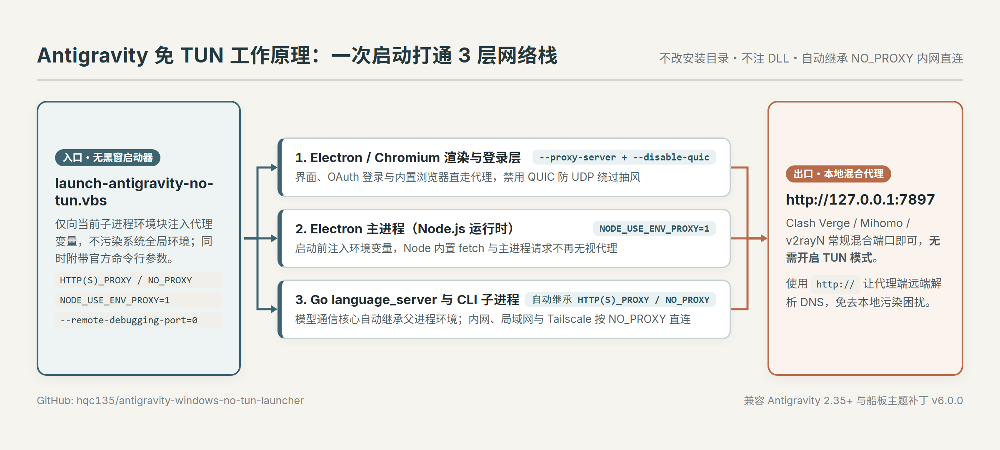
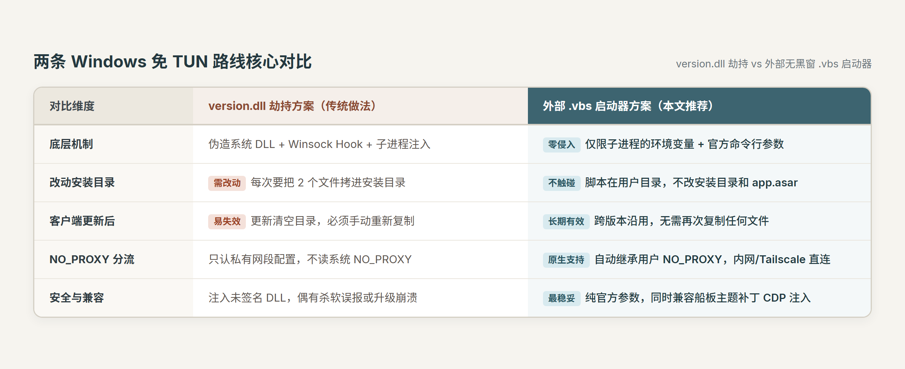

用了一段时间 Google Antigravity，最让人烦的往往不是模型配额，而是代理：开全局 TUN 容易把公司内网、局域网设备甚至 Tailscale 一起拖慢；不开 TUN，登录转圈、对话断连，社区最常见的解法是把 `version.dll` 和 `config.json` 塞进安装目录做 DLL 劫持——可客户端一自动更新，这两个文件就被清空，又得重新拷贝一遍。

其实完全没必要折腾 `version.dll`，也不用改 `app.asar`。在 Windows 上，一个 40 行的无黑窗 `.vbs` 启动器就能解决免 TUN，客户端以后怎么更新都不用再动手。

下面把背后的原因、现成配置步骤和两个小坑一次讲清楚，照着做三分钟就能搞定。

---

## 先搞懂一件事：为什么开了系统代理，Antigravity 还是连不上？

很多人卡在第一步：Clash Verge / Mihomo 明明开了系统代理，浏览器访问 Google 正常，偏偏 Antigravity 死活要开 TUN。

原因在于 Antigravity 启动后，底层其实是 **3 套各自为政的网络栈**：



1. **Electron / Chromium 层**（界面、登录弹窗）：会读系统代理或 `--proxy-server` 参数。
2. **Electron 主进程内置 Node.js**：默认无视 Windows 系统代理，除非启动前环境变量里就带了 `NODE_USE_ENV_PROXY=1` 和 `HTTP(S)_PROXY`。
3. **Go 编写的 `language_server` 子进程**：负责真正的模型通信与工具调度。Go 标准库默认不读 Windows 注册表里的系统代理，但它原生认 `HTTP_PROXY`、`HTTPS_PROXY`、`ALL_PROXY` 和 `NO_PROXY`。

这就是症结所在：只开 Windows 系统代理，只管住了第 1 层，第 2、3 层全在裸连。

---

## 两条免 TUN 路线对比：为什么放弃 `version.dll`？

以前常用的 `version.dll` 方案，本质是利用 Windows DLL 加载顺序劫持主程序，再通过 `child_injection` 往 `language_server` 和 `node.exe` 里注入 Hook，把 80/443 TCP 流量硬拗到本地 SOCKS5 端口。

另一种路线（受社区项目 `antigravity-context-viewer` 的外部启动器启发）则直接走正门：在拉起 `Antigravity.exe` 的那一刻，给这个进程单独挂上代理环境变量和 Chromium 启动参数。



对我来说，切换过来最立竿见影的好处有两点：一是客户端隔三差五自动升级后不用再去翻文件夹拷 DLL；二是我本机配了内网和国内直连的 `NO_PROXY`，切到启动器方案后，MCP 和局域网服务终于不再被误塞进代理。

---

## 三分钟上手：一键配置方法

我已经把整套脚本和一键安装/卸载工具整理到了 GitHub，代码全明文，几十行一眼就能看完：

- 仓库地址：`https://github.com/hqc135/antigravity-windows-no-tun-launcher`

### 第一步：拉取并执行安装脚本

先确认你的本地代理客户端（Clash Verge、Mihomo、v2rayN 等）已开启混合端口（默认按 `http://127.0.0.1:7897` 配置）。打开 PowerShell 执行：

```powershell
git clone https://github.com/hqc135/antigravity-windows-no-tun-launcher.git
cd antigravity-windows-no-tun-launcher
powershell -ExecutionPolicy Bypass -File .\install.ps1
```

如果你的代理端口不是 `7897`（比如老版 Clash 的 `7890` 或 v2rayN 的 `10809`），直接加参数指定：

```powershell
powershell -ExecutionPolicy Bypass -File .\install.ps1 -ProxyUrl "http://127.0.0.1:7890"
```

这个脚本只做三件干净的事：
1. 把无黑窗启动脚本 `launch-antigravity-no-tun.vbs` 放到 `%USERPROFILE%\.gemini\antigravity\scripts\`（脱离安装目录）；
2. 原地修改桌面和开始菜单的 `Antigravity.lnk`，指向 `wscript.exe` 调用该脚本，图标保持原样，桌面不会多出第二个图标；
3. 如果你之前放过 `version.dll` 和 `config.json`，自动把它们挪到 `%USERPROFILE%\.gemini\antigravity\backup-no-tun-dll\` 备份起来，方便随时回退。

### 第二步：完全退出并重开

关闭代理软件的 TUN 模式，**彻底退出 Antigravity**（确保托盘里没有残留），再双击桌面或开始菜单里的 `Antigravity` 图标启动。

### 脚本核心到底干了什么？

拆开 `launch-antigravity-no-tun.vbs`，核心逻辑就两块：

```vbscript
' 1. 仅写入当前子进程环境块，不污染系统全局环境变量
procEnv("HTTP_PROXY") = proxyUrl
procEnv("HTTPS_PROXY") = proxyUrl
procEnv("ALL_PROXY") = proxyUrl
procEnv("NO_PROXY") = noProxy
procEnv("NODE_USE_ENV_PROXY") = "1"

' 2. 携带 Chromium 代理参数、禁用 QUIC，并附带 CDP 端口参数
cmd = """" & exePath & """ --proxy-server=""" & proxyUrl & """ --proxy-bypass-list=""" & noProxy & """ --disable-quic --remote-debugging-port=0" & extraArgs
shell.Run cmd, 1, False
```

这里有两个容易忽略的小细节：
- **`--disable-quic`**：关掉 Chromium 的 QUIC（UDP），避免免 TUN 环境下 Google 接口走 UDP 绕开 HTTP 代理造成连接抽风。
- **`--remote-debugging-port=0`**：如果你同时在用「船板 Antigravity 主题、字体与汉化补丁（v6.0.0）」，带上这个参数可以让免 TUN 和主题/汉化/Token 统计一次性生效，不会冲突；如果不需要，安装时加上 `-DisableCdp` 即可去掉。

---

## 怎么确认真的摆脱了 TUN 和 `version.dll`？

重启 Antigravity 后，在 PowerShell 跑一行检查主进程命令行：

```powershell
Get-CimInstance Win32_Process -Filter "Name = 'Antigravity.exe'" |
  Where-Object { $_.CommandLine -notmatch '--type=' } |
  Select-Object ProcessId, CommandLine | Format-List
```

只要看到主进程命令行里带着 `--proxy-server="http://127.0.0.1:7897"` 和 `--disable-quic`，同时你在关掉 TUN 的情况下能正常发起对话，就说明三层网络栈全部走通了。

---

## 说在后面：这套方案的两个小代价

没有零缺点的方案，实际用下来有两处边界提前说清楚：

1. **软件内自动热更新重开的那一次会暂时掉代理**：Antigravity 检测到新版本并在内部自重启时，是直接拉起 `Antigravity.exe` 而不是走桌面快捷方式，所以更新弹窗重启完的那一次没有注入代理变量。解决办法也很简单——关掉窗口，重新双击一次桌面图标即可，比以前翻文件夹重新拷 `version.dll` 省事太多。
2. **端口写的是 `http://` 而非 `socks5://`**：建议优先填混合端口的 `http://127.0.0.1:7897`。这样域名解析会直接交给本地代理端处理，在 Go 和 Chromium 里都最稳；如果极少数网络环境下某个新组件硬编码不认环境变量，把备份目录里的 `version.dll` 拷回去就能无损还原，或者运行 `.\uninstall.ps1` 一键恢复原版快捷方式。

目前这套配置在 Antigravity 2.35.1 + Windows 11 + 船板主题补丁 v6.0.0 下跑得很稳。顺便问一句，大家在 Windows 上给这类 Electron + Go 混合架构的 AI IDE 做分流时，有没有遇到过某些内置 MCP 工具依然不吃 `NO_PROXY` 的情况？欢迎在评论区交流踩过的坑。
