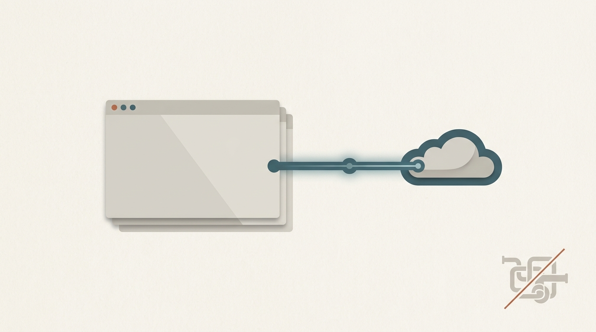
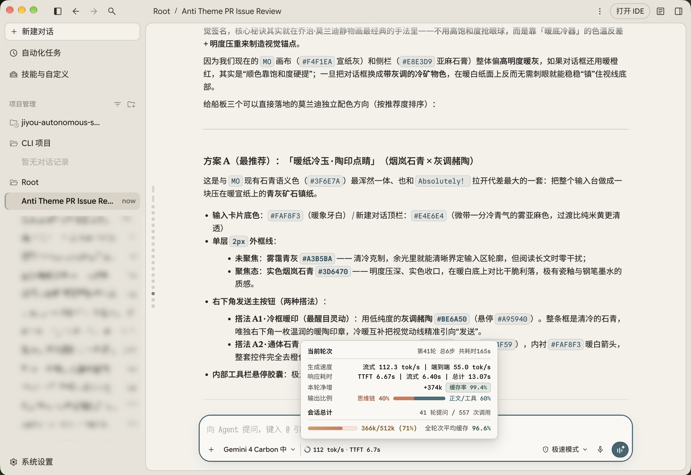

Windows 新手刚装好 Google Antigravity，通常会在两件事上卡壳：一是代理，开全局 TUN 容易把公司内网、局域网设备甚至 Tailscale 一起拖慢，不开 TUN 又得把 `version.dll` 塞进安装目录做劫持，客户端一自动更新就清空重来；二是界面全英文、默认中文字体发虚，想配合社区口碑很好的「船板主题汉化补丁」一起用，又怕快捷方式参数互相覆盖。

其实这两件事可以合在一起，用一套零侵入的组合一次性解决：用 40 行的无黑窗 `.vbs` 启动器接管代理，同时顺手把 CDP 调试端口参数留给船板主题补丁。不改 `app.asar`，不往安装目录放 DLL，客户端以后怎么更新都不用再重拷文件。

下面把原理、安装顺序和两个真实小坑讲清楚，照着做五分钟就能跑顺。

---

## 先搞懂一件事：为什么开了系统代理，Antigravity 还是连不上？

很多人卡在第一步：Clash Verge / Mihomo 明明开了系统代理，浏览器访问 Google 正常，偏偏 Antigravity 死活要开 TUN。

原因在于 Antigravity 启动后，底层其实是 **3 套各自为政的网络栈**：


1. **Electron / Chromium 层**（界面、登录弹窗）：会读系统代理或 `--proxy-server` 参数。
2. **Electron 主进程内置 Node.js**：默认无视 Windows 系统代理，除非启动前环境变量里就带了 `NODE_USE_ENV_PROXY=1` 和 `HTTP(S)_PROXY`。
3. **Go 编写的 `language_server` 子进程**：负责真正的模型通信与工具调度。Go 标准库默认不读 Windows 注册表里的系统代理，但它原生认 `HTTP_PROXY`、`HTTPS_PROXY`、`ALL_PROXY` 和 `NO_PROXY`。

这就是症结所在：只开 Windows 系统代理，只管住了第 1 层，第 2、3 层全在裸连。

---

## 两条免 TUN 路线对比：为什么放弃 `version.dll`？

以前常用的 `version.dll` 方案，本质是利用 Windows DLL 加载顺序劫持主程序，再通过 `child_injection` 往 `language_server` 和 `node.exe` 里注入 Hook，把 80/443 TCP 流量硬拗到本地 SOCKS5 端口。

另一种路线（受社区项目 `antigravity-context-viewer` 的外部启动器启发）则直接走正门：在拉起 `Antigravity.exe` 的那一刻，给这个进程单独挂上代理环境变量和 Chromium 启动参数。


切换过来最直观的收益有两点：一是客户端隔三差五自动升级后不用再去翻文件夹拷 DLL；二是如果本机配了内网或国内直连的 `NO_PROXY`，切到启动器方案后，MCP 和局域网服务终于不再被误塞进代理。

---

## 推荐搭配顺序：先装船板主题汉化，再挂免 TUN 启动器

如果你准备同时使用 **船板 Antigravity 主题、字体与汉化补丁（v6.0.0）**，强烈建议按「先装主题补丁 → 再装免 TUN 启动器」的顺序走一遍，快捷方式一步到位，省去来回改参数。

### 第一步：安装船板主题、字体与汉化补丁（v6.0.0）

船板补丁采用纯本地回环 CDP 注入，同样不改 `app.asar`、不破程序签名，默认提供莫兰迪古典矿物主题、5 套外观与 `[ EN | 中文 ]` 一键热切、`1,965` 条界面汉化、精细中西文字体搭配，以及输入框底栏实时速度/上下文指标胶囊和系统设置里的 Token 统计面板。

- 仓库地址：`https://github.com/Anarcadia/chuanban-antigravity-theme-patch`



安装要点（前提是本机已装 **Node.js `>= 22.13.0`**，这样才会启用 `node:sqlite` 实时指标胶囊与 Token 统计）：

1. 克隆仓库，或者直接把仓库 `README` 里的引导词发给 Antigravity 里的 Agent 让它自动部署：
   ```powershell
   git clone https://github.com/Anarcadia/chuanban-antigravity-theme-patch.git
   cd chuanban-antigravity-theme-patch
   node install.mjs doctor
   ```
2. 如果提示缺少字体，从仓库说明里的 Google Drive 共享目录下载 `AnthropicSerif-Regular/Bold.ttf`、`AnthropicMono-Regular.ttf` 以及 Windows 专用拆分包 `Windows-Sarasa-Split-SC-TTF-v1.0.43.zip`（千万别在 Windows 上直接装 791 MB 的单体 `Sarasa-SuperTTC.ttc`，容易拖卡 DirectWrite），解压后用内置命令写入注册表：
   ```powershell
   node install.mjs install-fonts --from "<字体解压目录>" --retire-super-ttc
   ```
3. 执行安装（注册 5 分钟保活计划任务与只读内核，默认启用 `morandi` 莫兰迪风格）：
   ```powershell
   node install.mjs install
   ```

先别急着重启，顺手把第二步的免 TUN 启动器也装上，一次重启同时生效。

### 第二步：安装无黑窗免 TUN 启动器

我已经把免 TUN 启动脚本和一键安装/卸载工具整理到了 GitHub，代码全明文，几十行一眼就能看完：

- 仓库地址：`https://github.com/hqc135/antigravity-windows-no-tun-launcher`

确认你的本地代理客户端（Clash Verge、Mihomo、v2rayN 等）已开启混合端口（默认按 `http://127.0.0.1:7897` 配置），在 PowerShell 执行：

```powershell
git clone https://github.com/hqc135/antigravity-windows-no-tun-launcher.git
cd antigravity-windows-no-tun-launcher
powershell -ExecutionPolicy Bypass -File .\install.ps1
```

如果本地代理端口不是 `7897`（比如老版 Clash 的 `7890` 或 v2rayN 的 `10809`），直接加参数指定：

```powershell
powershell -ExecutionPolicy Bypass -File .\install.ps1 -ProxyUrl "http://127.0.0.1:7890"
```

这个脚本只做三件干净的事：
1. 把无黑窗启动脚本 `launch-antigravity-no-tun.vbs` 放到 `%USERPROFILE%\.gemini\antigravity\scripts\`（脱离安装目录）；
2. 原地更新桌面和开始菜单的 `Antigravity.lnk`，指向 `wscript.exe` 调用该脚本，图标保持原样，桌面不会多出第二个图标；
3. 如果之前在安装目录放过 `version.dll` 和 `config.json`，自动移到 `%USERPROFILE%\.gemini\antigravity\backup-no-tun-dll\` 备份起来，随时可回退。

### 核心脚本为什么能同时兼顾两者？

拆开 `launch-antigravity-no-tun.vbs`，核心就两段：

```vbscript
' 1. 仅写入当前子进程环境块，不污染系统全局环境变量
procEnv("HTTP_PROXY") = proxyUrl
procEnv("HTTPS_PROXY") = proxyUrl
procEnv("ALL_PROXY") = proxyUrl
procEnv("NO_PROXY") = noProxy
procEnv("NODE_USE_ENV_PROXY") = "1"

' 2. 携带 Chromium 代理参数、禁用 QUIC，并保留船板主题需要的 CDP 端口参数
cmd = """" & exePath & """ --proxy-server=""" & proxyUrl & """ --proxy-bypass-list=""" & noProxy & """ --disable-quic --remote-debugging-port=0" & extraArgs
shell.Run cmd, 1, False
```

有两个细节省掉了很多隐性折腾：
- **`--disable-quic`**：关掉 Chromium 的 QUIC（UDP），避免免 TUN 环境下 Google 接口走 UDP 绕开 HTTP 代理造成连接抽风。
- **`--remote-debugging-port=0`**：把船板主题补丁需要的 CDP 调试端口直接融进启动参数，点一次桌面图标，免 TUN 代理和主题/字体/汉化/指标胶囊全部一起拉起，也不会触发船板守护进程的二次冷启动重拉（如果不需要船板主题，安装时加 `-DisableCdp` 即可去掉）。

---

## 第三步：重启客户端并一次验收两套配置

关闭代理软件的 TUN 模式，**彻底退出 Antigravity**（确保托盘无残留），再双击桌面或开始菜单的 `Antigravity` 图标重新打开。

打开 PowerShell，用两条命令验证：

**1. 验证免 TUN 启动器已接管**

```powershell
Get-CimInstance Win32_Process -Filter "Name = 'Antigravity.exe'" |
  Where-Object { $_.CommandLine -notmatch '--type=' } |
  Select-Object ProcessId, CommandLine | Format-List
```

看到主进程命令行里带着 `--proxy-server="http://127.0.0.1:7897"`、`--disable-quic` 和 `--remote-debugging-port=0`，且关闭 TUN 下能正常发起对话，说明免 TUN 生效。

**2. 验证船板主题与汉化注入成功**

```powershell
node "$HOME\.gemini\antigravity\theme-patch\install.mjs" verify
```

确认输出里包含 `"ok": true`、`"hasStyle": true`、`"dictCount": 1965` 与 `"pillMounted": true`，就代表全部验收通过。

> 顺带提一个小现象：装完我们的 `.vbs` 启动器后，如果你再跑 `install.mjs doctor`，里面会显示 `"launcherInstalled": false`。这不是报错，只是因为桌面快捷方式现在指向了 `wscript.exe`（再由它拉起 `Antigravity.exe`），只要 `cdpStatus` 显示 `"ready"` 且 `verify` 全绿就完全正常。

---

## 说在后面：这套组合的两个小代价

没有零缺点的方案，实际用下来有两处边界提前说清楚：

1. **软件内自动热更新重开的那一次会暂时掉代理**：Antigravity 检测到新版本并在内部自重启时，是直接拉起 `Antigravity.exe` 而不是走桌面快捷方式，所以更新弹窗重启完的那一次没有注入代理变量。解决办法很简单——关掉窗口，重新双击一次桌面图标，免 TUN 和主题就一起回来了，比以前每次翻文件夹重拷 `version.dll` 省事得多。
2. **端口建议填 `http://` 而非 `socks5://`**：优先填混合端口的 `http://127.0.0.1:7897`。这样域名解析直接交给本地代理端完成，在 Go 和 Chromium 里都最稳；如果极少数网络环境下某个新组件硬编码不认环境变量，把备份目录里的 `version.dll` 拷回去就能无损还原，或者分别运行 `.\uninstall.ps1` 和 `node "$HOME\.gemini\antigravity\theme-patch\install.mjs" uninstall` 一键恢复官方原版状态。

目前这套组合在 Windows 11 + Antigravity 2.35.1 + 船板主题补丁 v6.0.0 下跑得很稳。顺便问一句，大家在 Windows 上给这类 Electron + Go 混合架构的 AI IDE 做分流时，有没有遇到过某些内置 MCP 工具依然不吃 `NO_PROXY` 的情况？欢迎在评论区交流踩过的坑。
